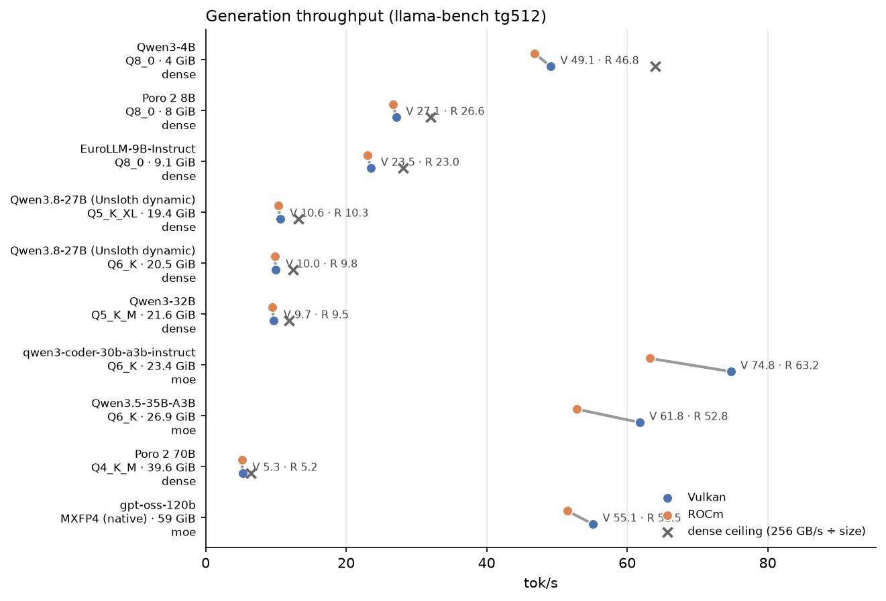
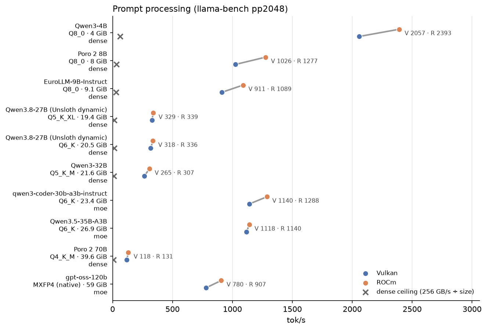
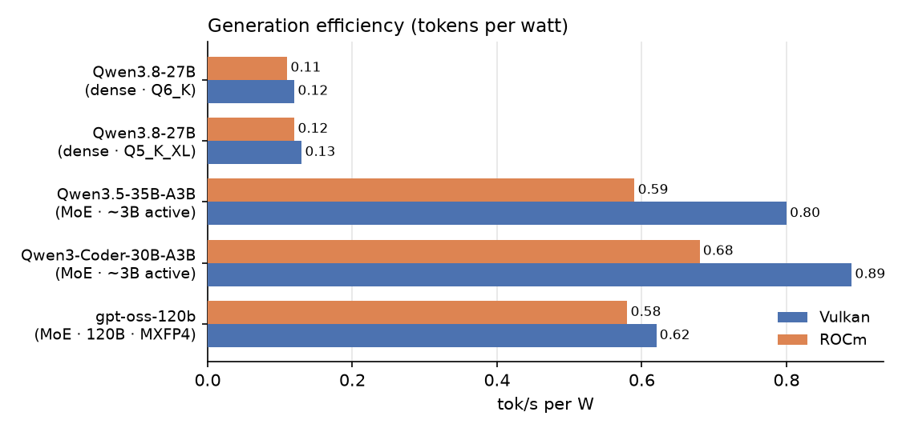
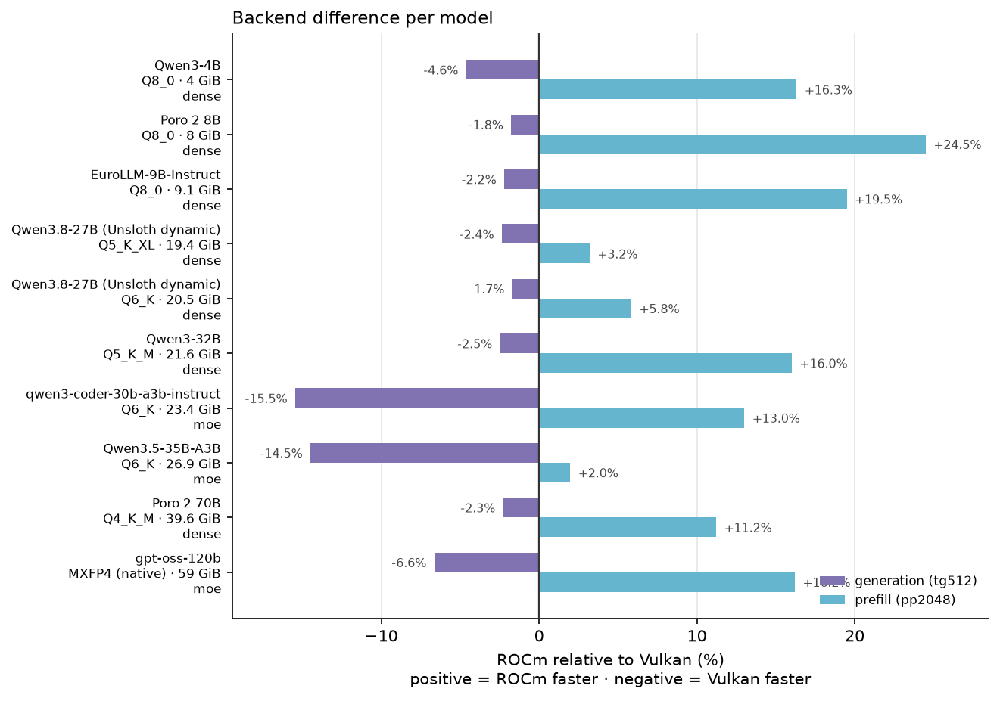

# Local LLM Benchmark Suite

Reproducible llama.cpp benchmarks for large language models on a single
unified-memory AMD APU — a Ryzen AI Max+ 395 ("Strix Halo") with 128 GB of
LPDDR5X. Ten model/quantization cells are measured on two backends (Vulkan and
ROCm) for throughput, latency, memory, power and tokens-per-watt, plus a
Finnish-capability axis on FIN-bench-v2.

Every number here was measured on the reference machine described below. The
drivers, the tracked rollups and the tests that re-derive the published
percentages are all in this repository, so the results can be checked rather
than trusted.

[](https://github.com/matnum/local-llm-benchmarks/actions/workflows/tests.yml)
[](#license)


## At a glance

- **10 cells × 2 backends.** Three MoE models (3–120B total, ~3B active for the
  mid-size ones) and seven dense models from 4B to 70B, all in GGUF.
- **A 120B-class model on a 128 GB APU.** gpt-oss-120b (native MXFP4, ~59 GiB)
  runs at **55.1 tok/s** generation (llama-bench) and 53.2 tok/s sustained
  streaming, at 0.62 tok/s per watt.
- **Vulkan wins generation, ROCm wins prompt processing — unanimously.**
  **Vulkan wins generation in 10 of 10 (ROCm trails by 1.7–15.5%) and ROCm wins
  prefill in 10 of 10 (by 2.0–24.5%).**
- **MoE models are 5–8× faster than dense models of similar footprint** at
  generation, and 5–8× more efficient per watt.
- **Dense models sit at 73–85% of the memory-bandwidth ceiling** (256 GB/s ÷
  model size in GiB), including the 39.6 GiB Poro 2 70B at 82% on Vulkan.
- **Finnish capability:** Poro 2 70B leads the FIN-bench-v2 `cf` axis at 0.629
  mean accuracy; at matched Q4_K_M, Poro 2 8B beats the English-centric
  Qwen3-8B by 10 points (0.530 vs 0.430).

## Contents

- [What is measured](#what-is-measured)
- [Hardware](#hardware)
- [Software](#software)
- [Benchmark matrix](#benchmark-matrix)
- [Results](#results)
- [Charts](#charts)
- [Finnish capability](#finnish-capability--fin-bench-v2)
- [Quick start](#quick-start)
- [Reproducibility](#reproducibility)
- [Repository layout](#repository-layout)
- [Limitations](#limitations)
- [License](#license)
- [Citation](#citation)
- [Acknowledgements](#acknowledgements)
- [Roadmap](#roadmap)

## What is measured

Each cell is one model at one quantization, on each backend, with `-ngl 99`
(every layer on the iGPU) and 16 CPU threads:

- **Generation throughput** — `llama-bench` `tg512` (mean of 3 repeats) and a
  sustained 512-token stream from `llama-server`.
- **Prompt processing** — `llama-bench` `pp512` and `pp2048`.
- **Time to first token** — three streaming requests; mean and median are both
  recorded, and the median is the one to quote (see [Limitations](#limitations)).
- **Memory** — peak iGPU VRAM and system availability, sampled at 5 Hz.
- **Power and efficiency** — GPU power during the bench and server phases, and
  tokens per watt.
- **Reproducibility metadata** — the pinned llama.cpp commit, the driver commit,
  CPU governor/EPP, both context sizes and the actual repeat counts are stamped
  into each run's `run.json`.

## Hardware

The reference machine — every number in this repository was measured on it:

| Component | Spec |
|---|---|
| CPU | AMD Ryzen AI Max+ 395 (Strix Halo), 16 cores / 32 threads |
| iGPU | Radeon 8060S (RDNA 3.5, 40 CUs), `gfx1151` |
| Memory | 128 GB unified LPDDR5X-8000 (~256 GB/s) |
| Storage | 2 TB NVMe |
| OS | CachyOS (Arch-based), kernel 7.2.8 at measurement time |

Unified memory lets the iGPU take most of the 128 GB — a 96 GiB iGPU allocation
was verified (`mem_info_vram_total` = 103,079,215,104 B), leaving ~30 GiB for
the system. The 50 TOPS XDNA 2 NPU is not a practical LLM path today and is not
benchmarked.

Machine fingerprint — driver and library versions, power source, kernel —
is in [docs/env.md](docs/env.md).

## Software

| Piece | Version |
|---|---|
| llama.cpp | pinned at `5b59b83f4` for all runs |
| Backend A — Vulkan | Mesa 26.2.3 RADV (`STRIX_HALO`), `-ngl 99`, 16 threads |
| Backend B — ROCm | ROCm 7.2.4 (HIP, ROCm-WMMA flash-attention); `gfx1151` detected natively |
| Driver | `scripts/run_sweep.py` — Python 3, stdlib + PyYAML |

The harness measures the model server and the build directly; there is no
`llama-cpp-python` in the loop.

## Benchmark matrix

Ten cells, all GGUF, each run on both backends. Machine-readable form plus the
run-parameter defaults: [matrix.yaml](matrix.yaml).

| Cell | Model | Quant | Size | Arch | Notes |
|---|---|---|---|---|---|
| `qwen3-4b-q8_0` | Qwen3-4B | Q8_0 | 4.0 GiB | dense | smallest cell; prefill reference |
| `poro2-8b-q8_0` | Poro 2 8B | Q8_0 | 8.0 GiB | dense | Finnish-focused |
| `eurollm-9b-q8_0` | EuroLLM-9B-Instruct | Q8_0 | 9.1 GiB | dense | European-language generalist |
| `qwen3.8-27b-q5_k_xl` | Qwen3.8-27B (Unsloth dynamic) | Q5_K_XL | 19.4 GiB | dense | quant pair |
| `qwen3.8-27b-q6_k` | Qwen3.8-27B (Unsloth dynamic) | Q6_K | 20.5 GiB | dense | quant pair |
| `qwen3-32b-q5_k_m` | Qwen3-32B | Q5_K_M | 21.6 GiB | dense | largest dense Qwen |
| `qwen3-coder-30b-a3b-q6_k` | Qwen3-Coder-30B-A3B-Instruct | Q6_K | 23.4 GiB | MoE | ~3B active |
| `qwen3.5-35b-a3b-q6_k` | Qwen3.5-35B-A3B | Q6_K | 26.9 GiB | MoE | ~3B active |
| `poro2-70b-q4_k_m` | Poro 2 70B | Q4_K_M | 39.6 GiB | dense | Finnish-focused; largest dense cell |
| `gpt-oss-120b-mxfp4` | gpt-oss-120b | MXFP4 (native) | 59.0 GiB | MoE | headline "120B on 128 GB" cell |

## Results

Both backends, every cell, rendered from the tracked rollup
[results/consolidated.csv](results/consolidated.csv). Rows are ordered by model
size; `server tg` is the sustained 512-token stream from `llama-server`, and
`TTFT p50` is the median of three streaming requests. Full per-cell detail —
power, temperature, per-request TTFT, benchmark context — is in
[results/table.md](results/table.md).

| Cell | Backend | pp2048 t/s | tg512 t/s | server tg t/s | TTFT p50 ms | tok/s/W | VRAM GiB |
|---|---|---|---|---|---|---|---|
| `qwen3-4b-q8_0` | vulkan | 2056.8 | 49.10 | 47.69 | 27.7 | 0.57 | 4.81 |
| `qwen3-4b-q8_0` | rocm | 2392.5 | 46.83 | 44.97 | 24.4 | 0.53 | 5.06 |
| `poro2-8b-q8_0` | vulkan | 1025.8 | 27.13 | 26.61 | 234.3 | 0.31 | 8.21 |
| `poro2-8b-q8_0` | rocm | 1277.2 | 26.65 | 26.16 | 41.9 | 0.31 | 8.47 |
| `eurollm-9b-q8_0` | vulkan | 911.4 | 23.54 | 23.06 | 48.7 | 0.27 | 9.48 |
| `eurollm-9b-q8_0` | rocm | 1089.1 | 23.02 | 22.57 | 47.2 | 0.26 | 9.74 |
| `qwen3.8-27b-q5_k_xl` | vulkan | 328.6 | 10.60 | 10.52 | 1631.9 | 0.13 | 19.06 |
| `qwen3.8-27b-q5_k_xl` | rocm | 339.2 | 10.35 | 10.23 | 137.3 | 0.12 | 19.65 |
| `qwen3.8-27b-q6_k` | vulkan | 317.7 | 10.01 | 9.96 | 809.1 | 0.12 | 20.09 |
| `qwen3.8-27b-q6_k` | rocm | 336.3 | 9.84 | 9.73 | 150.0 | 0.11 | 20.59 |
| `qwen3-32b-q5_k_m` | vulkan | 264.5 | 9.71 | 9.64 | 471.9 | 0.11 | 22.52 |
| `qwen3-32b-q5_k_m` | rocm | 306.9 | 9.47 | 9.31 | 113.2 | 0.11 | 22.79 |
| `qwen3-coder-30b-a3b-q6_k` | vulkan | 1140.1 | 74.75 | 71.46 | 162.8 | 0.89 | 23.76 |
| `qwen3-coder-30b-a3b-q6_k` | rocm | 1288.4 | 63.20 | 58.59 | 22.5 | 0.68 | 24.12 |
| `qwen3.5-35b-a3b-q6_k` | vulkan | 1118.0 | 61.77 | 60.26 | 688.5 | 0.80 | 27.10 |
| `qwen3.5-35b-a3b-q6_k` | rocm | 1140.1 | 52.82 | 50.80 | 58.1 | 0.59 | 27.46 |
| `poro2-70b-q4_k_m` | vulkan | 117.9 | 5.27 | 5.24 | 199.6 | 0.06 | 40.72 |
| `poro2-70b-q4_k_m` | rocm | 131.2 | 5.15 | 5.10 | 200.3 | 0.06 | 41.02 |
| `gpt-oss-120b-mxfp4` | vulkan | 780.4 | 55.12 | 53.18 | 143.9 | 0.62 | 59.09 |
| `gpt-oss-120b-mxfp4` | rocm | 906.9 | 51.46 | 49.59 | 67.2 | 0.58 | 59.36 |

**Vulkan wins generation in 10 of 10 (ROCm trails by 1.7–15.5%) and ROCm wins
prefill in 10 of 10 (by 2.0–24.5%).** The 2026-10-03 round of five additional
cells reproduces the split pairwise: Vulkan is faster on `tg512` in 5 of 5
(ROCm trails by 1.8–4.6%), and ROCm is faster on `pp2048` in 5 of 5 (by
11.2–24.5%) — the direction held from a 4B cell to a 39.6 GiB 70B.

Three things worth knowing before quoting these numbers:

- **The gaps are small on dense models and large on MoE.** ROCm's generation
  shortfall is 1.7–4.6% on the seven dense cells, but 15.5% on
  Qwen3-Coder-30B-A3B and 14.5% on Qwen3.5-35B-A3B. Prefill goes the other
  way: ROCm's advantage is narrowest on Qwen3.5-35B-A3B (2.0%) and widest on
  Poro 2 8B (24.5%).
- **MoE cells are 5–8× faster at generation and 5–8× more efficient per watt**
  than the dense 27–32B cells: 74.75 tok/s at 0.89 tok/s/W
  (Qwen3-Coder-30B-A3B) and 61.77 at 0.80 (Qwen3.5-35B-A3B), against 9.5–10.6
  tok/s at 0.11–0.13 for the dense cells. A few billion active parameters do
  most of the work.
- **Dense cells run at 73–85% of the bandwidth ceiling** (256 GB/s ÷ model size
  in GiB). The 39.6 GiB Poro 2 70B reaches 5.27 tok/s against a 6.46 tok/s
  ceiling — 82% on Vulkan, 80% on ROCm — and the 4B cell reaches 77% on Vulkan.
  The MoE cells clear the ceiling outright, which is the point of the
  architecture.

ROCm runs hotter throughout: 83–91 °C across the ten cells against 69–85 °C on
Vulkan, with the Qwen3-4B cell the hottest measured at 91 °C. Temperature is
logged per run.

> **Before quoting a TTFT, read [docs/RUNNING.md](docs/RUNNING.md) §7.** On
> Vulkan the first timed request is much faster than the next two, so the mean is
> misleading; this table reports the median, and `results/table.md` prints both
> the mean and the p50. That Vulkan spread is an open finding, not a harness bug.

## Charts

All ten cells, both backends, ordered by model size (small → large). Each row is
one model with its Vulkan and ROCm results joined by a line, so the pair *and the
size of the gap* read directly. On the generation chart the dense-model
bandwidth ceiling is marked ✕ where it applies.







The backend split as a single picture — bars are ROCm relative to Vulkan, so
positive is ROCm faster and negative Vulkan faster:



The figures are generated from `results/consolidated.csv` by
`scripts/make_charts.py` (Vulkan = blue, ROCm = orange). Each PNG carries a
fingerprint of the rollup it was drawn from, and `tests/test_charts.py` fails
when a committed chart no longer matches the data — a stale figure cannot ship
next to fresh numbers.

## Finnish capability — FIN-bench-v2

Throughput says nothing about whether a model writes good Finnish. This is the
official [FIN-bench-v2](https://huggingface.co/datasets/TurkuNLP/FIN-bench)
suite, run on the same pinned llama.cpp build by `tools/score_ll` +
`scripts/finbench.py` (see
[docs/RUNNING.md](docs/RUNNING.md#9-finnish-capability-axis--fin-bench-v2-cf--p0)
for why it needs its own scorer).

Five models × the five task families that have a `cf` variant × prompt variant
`p0`, zero-shot — 7,296 items per model, all scored: no skips, no context
overflows, no unusable gold indices. Cells are **acc / acc_norm**; `acc_norm`
divides the choice loglikelihood by its character length, exactly as the
harness does. Full detail: [results/finbench-table.md](results/finbench-table.md).

| Model | arc_c | belebele_fin | goldenswag | scandisent | sib200 | mean acc |
|---|---|---|---|---|---|---|
| `poro2-70b-q4_k_m` | 0.455 / 0.486 | 0.570 / 0.470 | 0.649 / 0.714 | 0.954 / 0.954 | 0.518 / 0.435 | **0.629** |
| `eurollm-9b-q8_0` | 0.421 / 0.445 | 0.537 / 0.471 | 0.521 / 0.587 | 0.944 / 0.944 | 0.596 / 0.567 | 0.604 |
| `poro2-8b-q8_0` | 0.396 / 0.420 | 0.469 / 0.417 | 0.587 / 0.638 | 0.942 / 0.942 | 0.356 / 0.263 | 0.550 |
| `poro2-8b-q4_k_m` | 0.389 / 0.420 | 0.452 / 0.407 | 0.579 / 0.630 | 0.922 / 0.922 | 0.306 / 0.217 | 0.530 |
| `qwen3-8b-q4_k_m` | 0.310 / 0.364 | 0.434 / 0.410 | 0.389 / 0.344 | 0.499 / 0.499 | 0.515 / 0.611 | 0.430 |

Three findings:

- **Finnish adaptation buys a lot at equal size.** Quant-matched at Q4_K_M,
  Poro 2 8B beats the English-centric Qwen3-8B by 10 points of mean accuracy
  (0.530 vs 0.430), winning four of five tasks: +7.9 points on arc_c, +19.0 on
  goldenswag and +42.3 on scandisent. The Q8_0 Poro 2 8B scores 0.550, so an
  unmatched Q8-vs-Q4 comparison overstates the gap by about 2 points.
- **Sentiment is a cliff, not a gradient.** Qwen3-8B scores 0.499 on a binary
  task — exactly chance — where every Finnish-capable model is at ~0.94. It
  cannot produce "positiivinen"/"negatiivinen" as continuations at all.
- **The Finnish-specific model loses topic classification.** sib200 is the one
  task where Poro 2 8B trails Qwen3-8B (0.356 Q8_0 / 0.306 Q4_K_M vs 0.515); the
  70B only ties it at 0.518, while the generalist EuroLLM-9B leads at 0.596.
  Finnish adaptation is not uniformly better: EuroLLM-9B beats the
  Finnish-focused Poro 2 8B on mean accuracy (0.604 vs 0.550 / 0.530), though
  the larger Poro 2 70B still leads overall at 0.629.

Caveats before quoting these: the Poro 2 8B vs Qwen3-8B comparison is
**quant-matched** (both Q4_K_M) — the twin pins the quant effect at ~2 points
(0.550 → 0.530), not the whole gap — while the EuroLLM-9B and Poro 2 8B Q8_0
cells still differ in quant from their neighbours; this is the `cf` formulation
at one prompt variant, so it is not comparable with published FIN-bench tables
(the paper notes formulation effects, singling out Poro 2 70B as strong in CF
specifically); `goldenswag` is scored on its `train` split because its test
labels are withheld upstream; and GPU-vs-CPU logprob numerics differ by up to
~0.12, harmless for a task score but able to flip a near-tie.

## Quick start

The harness needs a Python 3 that can `import yaml` and, for the charts and the
full test suite, matplotlib. No GPU is needed to run the tests or rebuild the
rollups.

```bash
git clone https://github.com/matnum/local-llm-benchmarks.git
cd local-llm-benchmarks
python3 -m pip install -r requirements.txt

python3 -m unittest discover -s tests -t . -v    # full suite, no GPU
```

A sweep needs the models on disk, a pinned llama.cpp build and an idle GPU:

```bash
python3 scripts/run_sweep.py --backend vulkan    # 10-cell sweep
python3 scripts/run_sweep.py --backend rocm
python3 scripts/run_sweep.py --consolidate       # rebuild rollups, no GPU
python3 scripts/make_charts.py                   # redraw charts from the rollup
```

Prerequisites, per-cell behaviour, GPU-idle checks and the FIN-bench axis are in
[docs/RUNNING.md](docs/RUNNING.md). On the reference machine use
`/usr/bin/python3`: a `python3` from a venv without PyYAML is refused with an
install hint rather than silently running a different matrix.

## Reproducibility

What is pinned, and where:

- **llama.cpp** at `5b59b83f4` for every run. Both backends are builds of that
  same commit.
- **Run parameters** live in `matrix.yaml` (`defaults:`), not in code, and are
  wired into the driver's argparse defaults — a test fails if the two drift.
- **Each run** records the driver commit, llama.cpp commit, CPU governor/EPP,
  both context sizes and the real repeat counts in `run.json`.
- **Raw run directories** (`results/run-*/`) are gitignored: large and
  machine-specific. The rollups (`results/consolidated.csv`, `results/table.md`,
  `results/finbench-consolidated.csv`, `results/finbench-table.md`) are tracked,
  and the suite rebuilds them from the per-run data to catch drift.
- **Published numbers are tested.** The percentages in this README are
  recomputed from the rollup by `tests/test_readme_ranges.py`, and the results
  and FIN-bench tables are diffed against the rollups by
  `tests/test_readme_tables.py`. CI runs both on every pull request.

## Repository layout

| Path | What |
|---|---|
| `scripts/run_sweep.py` | the sweep driver (stdlib + PyYAML) |
| `scripts/sampler.py`, `scripts/ttft_probe.py` | stdlib helpers: power/VRAM trace, TTFT probe |
| `scripts/finbench.py` | FIN-bench-v2 driver (stdlib + PyYAML) |
| `scripts/make_charts.py` | regenerates the charts from the rollup (needs matplotlib) |
| `tools/score_ll.cpp` | loglikelihood scorer for the FIN-bench axis, linked against the pinned llama.cpp |
| `matrix.yaml` | the benchmark matrix and the run-parameter defaults |
| `docs/RUNNING.md` | operator guide: prerequisites, per-cell behaviour, caveats |
| `docs/env.md` | machine fingerprint at measurement time |
| `docs/reviews/` | independent reviews, with resolution notes |
| `results/` | tracked rollups; raw run directories are gitignored |
| `charts/` | generated figures, fingerprinted against the rollup |
| `tests/` | unittest suite: parser/rollup, FIN-bench transforms, README tables and ranges, charts, scorer golden |
| `PLAN.md` | methodology decisions and the reasoning behind them |
| `CONTRIBUTING.md` | how to add a cell, and what a results PR must include |

## Limitations

- **One machine, one stack.** Every number comes from a single Ryzen AI Max+ 395
  board on CachyOS with Mesa 26.2.3 and ROCm 7.2.4. Another board, driver or
  kernel can move them, especially the Vulkan/ROCm split.
- **GPU power only.** Power is read from the amdgpu hwmon, not the whole SoC, so
  tokens-per-watt understates the energy cost of prompt processing.
- **Two contexts.** `llama-bench` runs at the model-default context (4096) and
  `llama-server` at 8192. Do not compare a bench number to a server number as if
  they were measured at the same context.
- **Vulkan TTFT spread.** The first timed request is much faster than the next
  two on Vulkan, so the mean is misleading; medians are reported and the
  per-request values are in `results/table.md`. An open finding, not a bug.
- **No error bars.** Three repeats catch a broken run; they do not support a 1%
  claim. Differences under ~2% are within noise for this setup.
- **FIN-bench is one formulation.** `cf` at prompt variant `p0` only. `mcf` and
  `p1`–`p4` are unmeasured, and formulation is known to move scores.
- **Quantizations differ across the matrix.** The Finnish comparison is
  quant-matched; the throughput matrix is not — each cell uses the quant that
  fits the footprint being tested.

## License

Code and scripts are MIT-licensed — see [LICENSE](LICENSE). The published
results (`results/`, `charts/`) and this README are licensed under
[CC BY 4.0](https://creativecommons.org/licenses/by/4.0/): reuse them, including
commercially, with attribution to this repository.

## Citation

If you use these numbers or the harness, cite the repository. Machine-readable
metadata is in [CITATION.cff](CITATION.cff):

```bibtex
@software{nummenpaa_llm_benchmarks_2026,
  author  = {Nummenpää, Matias},
  title   = {Local LLM Benchmark Suite: llama.cpp inference benchmarks on an AMD Ryzen AI Max+ 395},
  year    = {2026},
  url     = {https://github.com/matnum/local-llm-benchmarks},
  license = {MIT}
}
```

## Acknowledgements

- [llama.cpp](https://github.com/ggml-org/llama.cpp) — the runtime under test,
  pinned at `5b59b83f4`.
- [TurkuNLP](https://turkunlp.org/) for
  [FIN-bench-v2](https://huggingface.co/datasets/TurkuNLP/FIN-bench) and the
  dataset families behind it.
- The model authors and GGUF quantizers whose work is measured here: OpenAI
  (gpt-oss), Qwen, Poro (Silo AI), EuroLLM, and the maintainers of the
  [Unsloth](https://huggingface.co/unsloth) dynamic quantizations.

## Roadmap

- **Finnish capability, wider** — the `mcf` formulation and prompt variants
  `p1`–`p4`.
- **An English/general quality axis** — strict-JSON extraction, function
  calling, and a GSM8K-style math subset over the same cells.
- **Embeddings** — bge-m3 vs nomic-embed-text on a Finnish retrieval set.
- **Vulkan TTFT root cause** — one experiment to separate prompt-cache reuse
  from a per-request Vulkan cost.
- **Wider matrix.** One-time downloads, not yet swept: gpt-oss-20b (MXFP4),
  Qwen3-30B-A3B (Q4_K_M), Llama 3.1 8B (Q8_0), Mistral Small 3.2 24B (Q4_K_M),
  Gemma 3 27B (Q4_K_M), Llama 3.3 70B (Q4_K_M).

Methodology decisions, including the ones deliberately reversed, are recorded in
[PLAN.md](PLAN.md). Independent reviews of this repository live in
[docs/reviews/](docs/reviews/).
